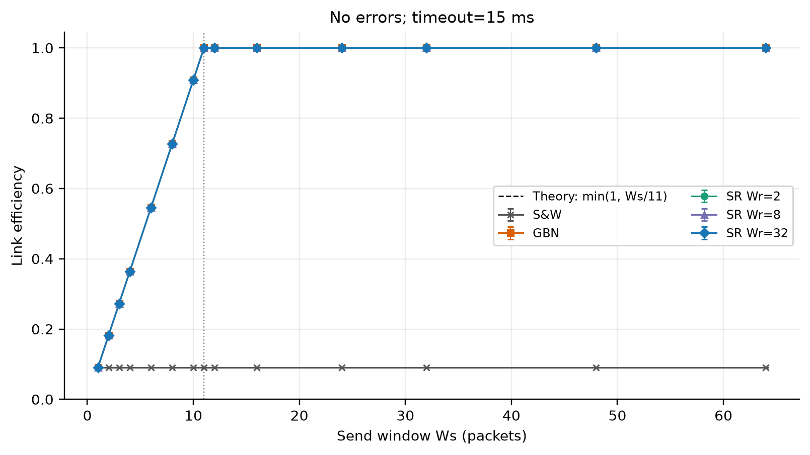
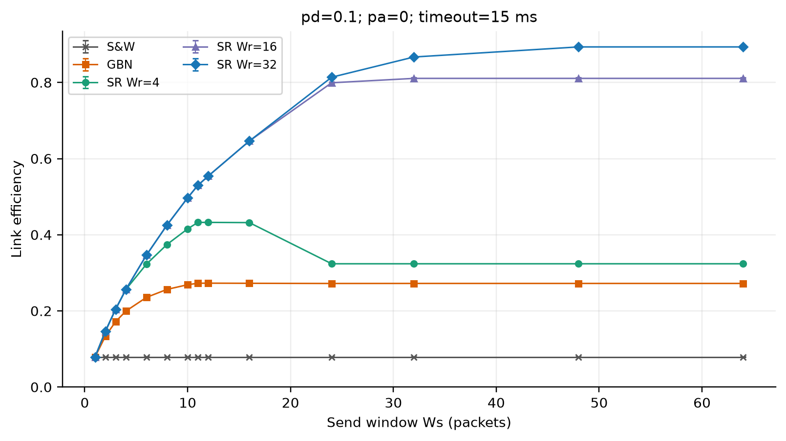
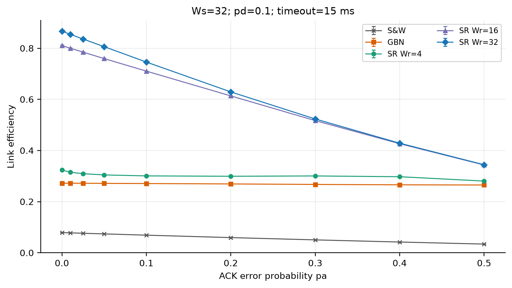
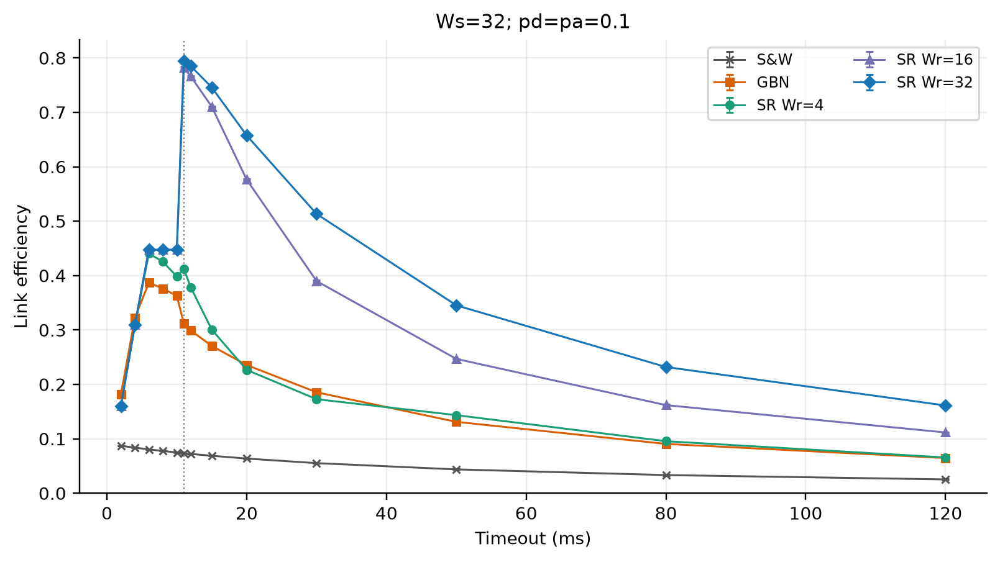
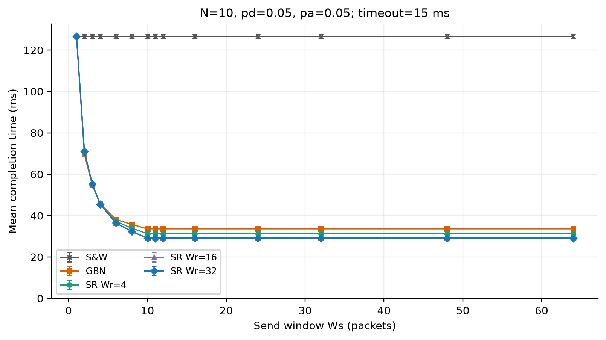
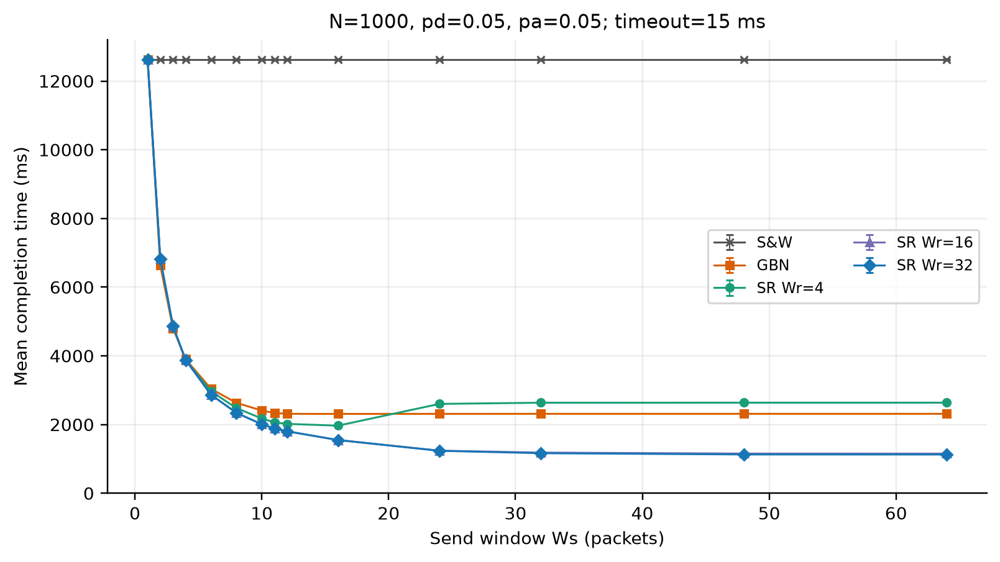

# COMPENG 4DK4: Lab 4 Report

Group 25

Instructor: Dr. Dongmei Zhao

Ali Naqvi (400450701), Jawad Ali (400327698), Arji Thaiyib (400336020)

## Simulation Design:

We simulated S&amp;W, GBN, and SR over one point-to-point link. Packets contain 1000 bits and the link rate is 1 Mbps, so transmission takes 1 ms. Propagation takes 5 ms each way. ACK transmission and processing times are ignored. The earliest ACK returns 11 ms after transmission begins, and the default timeout is 15 ms [1].

The simulator processes four events: transmission end, data arrival, ACK arrival, and timeout. It tracks the sender's oldest unacknowledged packet, next sequence number, link state, ACK flags, and timers. The receiver tracks its next expected packet and buffered packets. Only one data packet can be transmitted at a time, while propagation and ACK reception can overlap other transmissions.

Ws limits the sender window and Wr limits the receiver window. With Wr &gt; 1, SR buffers packets within its window, acknowledges them individually, and retries only packets whose timers expire. Wr = 1 selects GBN: out-of-order packets are discarded, ACKs are cumulative, and a timeout queues all outstanding packets for retransmission. Ws = Wr = 1 gives S&amp;W. These modes share the same event engine and link model.

Timers start when transmission begins. SR maintains one timer per packet. GBN uses one timer for the oldest outstanding packet and restarts it when a cumulative ACK advances the window. Retries take priority over new packets but cannot interrupt a transmission. ACKs cancel pending retries. If an ACK and timeout occur together, the ACK is processed first.

Each transmission fails independently with probability pd. A damaged packet is discarded without an ACK. Each generated ACK independently fails with probability pa, using a separate random stream. Received duplicates are acknowledged again but delivered only once. SR discards packets beyond its receive window without ACKing them. Packets are delivered in order. We assume fixed propagation delay, no sequence-number wraparound, and no NAK or fast-retransmission mechanism.

Link efficiency is the number of newly delivered packets times 1 ms divided by the measurement duration. Attempts per delivered packet counts all initial transmissions and retries. For finite transfers, all N packets are available at t=0; completion occurs only when the source has ACKs covering every packet.

## Experimental Setup:

Backlogged runs use 50,000 ms of warmup followed by 500,000 ms of measurement. Error cases use seeds 400450701, 400327698, 400336020, 104729, and 130363, including all three group members' student numbers. The same seeds are used for every protocol. Finite transfers use 200 repetitions per seed, giving 1000 transfers per point, with no warmup. Error-free cases are deterministic and use one run.

Table 1. Experiment settings. Timeout is 15 ms unless varied; S&W always uses Ws=Wr=1.

| Experiment | Varied | Fixed settings |
| --- | --- | --- |
| 1 | (pd,pa)=(0,0), (0.5,0.5) | N=4; S&W (1,1), GBN (4,1), SR (4,4); seed 400450701 |
| 2 | Ws; SR Wr=2,8,32 | pd=pa=0 |
| 3(a) | pd; SR Wr=4,16,32 | Ws=32; pa=0 |
| 3(b) | Ws; SR Wr=4,16,32 | pd=0.1; pa=0 |
| 4 | pa; SR Wr=4,16,32 | Ws=32; pd=0.1 |
| 5 | Timeout; SR Wr=4,16,32 | Ws=32; pd=pa=0.1 |
| 6 | Ws; three error cases | N=100; SR Wr=4,16,32 |
| 7 | Ws; N=10,1000 | pd=pa=0.05; SR Wr=4,16,32 |

Ws values are 1, 2, 3, 4, 6, 8, 10, 11, 12, 16, 24, 32, 48, and 64. The pd sweep is 0, 0.01, 0.025, 0.05, 0.1, 0.15, 0.2, 0.3, 0.4, and 0.5. The pa sweep uses the same values except 0.15. Timeouts are 2, 4, 6, 8, 10, 11, 12, 15, 20, 30, 50, 80, and 120 ms. Experiment 6 uses (pd,pa)=(0,0), (0.05,0), and (0.05,0.05).

Plot markers show measured means, with straight connecting segments as visual guides and no fitted curves. Error bars are 95% confidence intervals: across five seed means for backlogged runs and across 1000 transfers for finite cases. Some intervals are smaller than the markers. Selected backlogged points were checked with four times the run length; mean efficiency changed by at most 0.54%.

Without errors, the expected efficiency is 1/11 for S&amp;W and min(1,Ws/11) for GBN and SR. For S&amp;W with Tout at least 11 ms, let q=(1-pd)(1-pa). Its expected efficiency is q/[11q+Tout(1-q)], and expected attempts per packet is 1/q. These account for the extra waiting after failed transmissions.

## Lab Experiments: Experiment 1

We transferred four packets, numbered 0 to 3, using timeout 15 ms. Table 2 gives short traces for each required error setting. Times are in ms. Complete event logs are included with the code.

Table 2. Verification traces with Ws=1 for S&W and Ws=4 for GBN/SR; Wr=4 for SR.

| Protocol | pd=pa | Selected trace events |
| --- | --- | --- |
| S&W | 0 | Send packets 0-3 at 0,11,22,33; deliver at 6,17,28,39; receive ACKs at 11,22,33,44. Finish at 44. |
| GBN | 0 | Send 0-3 at 0,1,2,3; deliver at 6,7,8,9; receive ACKs at 11,12,13,14. Finish at 14. |
| SR | 0 | Send 0-3 at 0,1,2,3; deliver at 6,7,8,9; receive ACKs at 11,12,13,14. Finish at 14. |
| S&W | 0.5 | 6: data 0 lost. 15: retry 0. 36: deliver 0. 41: receive ACK 0. 62: deliver 1, ACK 1 lost. 71: retry 1. Finish at 299. |
| GBN | 0.5 | 6: data 0 lost. 8: discard out-of-order packet 2. 15-18: retry packets 0-3. 21: deliver 0, ACK 0 lost. 36: receive duplicate 0 without another delivery. Finish at 101. |
| SR | 0.5 | 6: data 0 lost. 8: buffer 2. 13: receive ACK 2. 15: retry 0. 21: deliver 0, ACK 0 lost. 30: retry 0. 37: receive 1 and deliver buffered 2,3. Finish at 164. |

The error-free traces confirm 6 ms from transmission start to data arrival and another 5 ms for the ACK. Under errors, S&amp;W waits for timeout, GBN retries the outstanding window, and SR retains correctly received packets behind a gap. Lost ACKs cause duplicates, which are acknowledged without duplicate delivery.

We also checked exact error-free completion times, isolated data and ACK losses, short timeouts, simultaneous ACK/timeout events, and in-order delivery. All ten automated test methods passed. For a single lost first data packet with N=4 and Ws=4, GBN took 29 ms and eight attempts, while SR took 26 ms and five attempts. When only the first ACK was lost, GBN still finished in 14 ms because a later cumulative ACK covered it; SR required a retry and finished in 26 ms.

## Experiment 2:

Figure 1. Link efficiency versus Ws with pd=pa=0. GBN and all SR curves overlap.

Efficiency follows min(1,Ws/11): it is 0.3636 at Ws=4, 0.9091 at Ws=10, and 1.0000 at Ws=11 and above. S&amp;W stays at 0.0909. Below 11 packets, the sender fills its window before the first ACK returns and must leave the link idle. Ws=11 covers the full feedback cycle; larger windows cannot increase link capacity.

GBN and SR have the same error-free performance. All packets arrive in order, so the receiver window advances immediately and extra buffering is unnecessary. Changing SR's Wr from 2 to 8 or 32 therefore has no effect. Simulation results differ from the analytical efficiency by less than 0.00002.

## Experiment 3(a):

Figure 2. Efficiency versus pd with Ws=32, pa=0, and SR Wr=4,16,32.

At pd=0.1, GBN efficiency is 0.2722, compared with 0.3238, 0.8108, and 0.8670 for SR with Wr=4,16,32. GBN discards packets arriving after a gap; SR can retain them if its receive window is large enough. At pd=0.5, GBN falls to 0.0478 while SR with Wr=32 reaches 0.3909.

The standard analytical references [2] are 1-pd for ideal SR and (1-pd)/(1+10pd) for GBN with an approximate 11-packet retransmission span. At pd=0.1 these predict 0.9 and 0.45. Finite windows make SR wait behind missing packets, while GBN's timeout and actual outstanding window add recovery cost not captured by that approximation. Small Wr can also cause SR to discard valid packets beyond its window. S&amp;W gives 0.0789, matching its timeout-aware prediction (1-pd)/(11+4pd)=0.07895.

## Experiment 3(b):

Figure 3. Efficiency versus Ws with pd=0.1 and pa=0.

Figure 4. Attempts per delivered packet for the same runs.

With Wr=32, SR efficiency rises from 0.5300 at Ws=11 to 0.8935 at Ws=64. Attempts stay near the data-error minimum 1/0.9=1.111 while Ws is at most 32. Extra sender space helps keep the link busy during recovery.

For Wr=4, increasing Ws from 11 to 32 reduces efficiency from 0.4325 to 0.3238 and raises attempts from 1.723 to 3.088 because packets fall outside the receive window. GBN stays near 0.272 efficiency above Ws=11, while attempts rise to 3.674 at Ws=32. A larger send window alone cannot overcome receiver discards.

## Experiment 4:

Figure 5. Efficiency versus pa with pd=0.1 and the windows from Part 3(a).

Figure 6. Attempts per delivered packet versus pa.

As pa rises from 0 to 0.5, SR with Wr=32 falls from 0.8670 to 0.3443 efficiency and increases from 1.111 to 2.220 attempts. S&amp;W efficiency falls from 0.0789 to 0.0340. Missing individual ACKs cause retries even when data was delivered.

GBN changes much less, from 0.2722 to 0.2651 efficiency, because later cumulative ACKs cover earlier lost ACKs. Data loss is more damaging because it leaves a reception gap. At pa=0.5, SR Wr=16 and Wr=32 perform similarly: feedback waiting limits both. With Wr=4, ACK-induced waiting reduces some out-of-window discards, so attempts need not increase monotonically, although efficiency still falls.

## Experiment 5:

Figure 7. Efficiency versus timeout with pd=pa=0.1 and Ws=32 for GBN/SR.

Figure 8. Attempts per delivered packet; the dotted line marks the 11 ms feedback cycle.

At 2 ms, premature retries cost about 6.23 attempts per packet for S&amp;W and SR. SR Wr=32 reaches its highest measured efficiency, 0.7943, at 11 ms, when ACKs arrive before timeout. At 120 ms it falls to 0.1613 because recovery waits are long. Delay variation would require a margin above 11 ms.

S&amp;W can gain efficiency from short timeouts by sending copies during otherwise idle waiting, but wastes transmissions. GBN also benefits from faster gap recovery at some short settings, while its group retries increase overhead. For sufficiently buffered SR, timeouts above 11 ms mainly add waiting; small Wr also creates discards, making its attempt count nonmonotonic.

## Experiment 6:

Figure 9. N=100 without data or ACK errors.

Figure 10. N=100 with pd=0.05 and pa=0.

Without errors, GBN and SR finish in 278 ms at Ws=4 and 110 ms at Ws=11 or larger. The latter is 100 ms of transmission plus 10 ms until the final ACK returns. S&amp;W takes 1100 ms; Wr has no effect because packets arrive in order.

With data errors, Ws=32 gives 237.04 ms for GBN and 186.69, 122.58, and 121.11 ms for SR Wr=4,16,32. Buffering avoids retransmitting later packets. Larger Ws helps well-buffered SR, but Wr=4 worsens from 180.10 ms at Ws=11 to 186.69 ms at Ws=32 due to extra discards.

## Experiment 6: Data and ACK Errors

Figure 11. N=100 with pd=pa=0.05. Error bars show 95% confidence intervals.

At Ws=32, GBN takes 238.57 ms, while SR takes 218.97, 133.58, and 131.88 ms for Wr=4,16,32. Compared with data errors alone, ACK errors add only 1.53 ms for GBN but 10.77 ms for SR Wr=32. Cumulative ACKs often recover GBN's lost feedback; SR must recover individual ACKs.

S&amp;W increases to 1263.23 ms. Its expected mean is 100[11+15(1-q)/q]=1262.05 ms for q=0.95 squared, within the measured interval. Finite transfers must wait for the final ACK, so losing it delays completion even when the receiver already has the whole file. Increasing SR Wr=32's send window from 32 to 64 reduces its mean to 129.15 ms, a much smaller gain than increasing Ws from 11 to 32.

## References:

[1] Computer Engineering 4DK4, Lab 4: Simulation of ARQ Protocols, 2026, pp. 1-5.

[2] Simon S. Lam, Chapter 3: Transport Layer, University of Texas at Austin, 2017, slides 3-44 to 3-47. ARQ performance analysis.

## Experiment 7:

Figure 12. N=10 with pd=pa=0.05; other settings match Experiment 6.

Figure 13. N=1000 with the same error probabilities.

At Ws=32, GBN takes 33.62, 238.57, and 2312.50 ms for N=10,100,1000; SR Wr=32 takes 29.18, 131.88, and 1165.45 ms. Small files are strongly affected by final-ACK delay and gain nothing from Ws exceeding N. Larger files show the sustained benefit of buffering during error recovery.

For N=1000, SR Wr=4 worsens from 2063.08 ms at Ws=11 to 2635.79 ms at Ws=32 because the larger sender outruns its receive window. Increasing file size does not remove that limitation. These results show why both window sizes matter when selecting settings for a finite transfer.
