# COMPENG 4DK4: Lab 4 Report

Group 25

Instructor: Dr. Dongmei Zhao

Ali Naqvi (400450701), Jawad Ali (400327698), Arji Thaiyib (400336020)

## Simulation Design:

We built a discrete-event simulator for one source, one destination, and one point-to-point link. Each data packet contains 1000 bits and the link rate is 1 Mbps, giving a transmission time of 1 ms. Propagation takes 5 ms in each direction. ACK transmission and processing times are zero. An error-free ACK therefore returns 11 ms after the data transmission starts. The default retransmission timeout is 15 ms [1].

The simulator uses the same transmission link, event queue, and receiver for all three protocols. Ws limits the number of sequence positions outstanding at the sender. Wr limits the receiver's acceptance window. With Wr &gt; 1, the receiver buffers packets and sends individual ACKs; each outstanding packet has its own timer. Wr = 1 selects GBN: the receiver accepts only its next expected packet, returns cumulative ACKs, and the sender uses one timer for its oldest outstanding packet. Ws = Wr = 1 gives S&amp;W. Setting Wr = 1 also changes the ACK and retransmission rules; a one-packet SR buffer alone would not implement conventional GBN.

Table 1. Events used by the simulator.

| Event | State change |
| --- | --- |
| Transmission end | Free the data link so another packet can start. |
| Data arrival | Apply a data error trial. If valid, accept, buffer, or discard the packet; generate the appropriate ACK. |
| ACK arrival | Mark acknowledged data, advance the send base, and cancel pending retries where possible. |
| Timeout | Queue one packet for SR, or all outstanding packets in sequence order for GBN. |

Sender state includes the send base, next new sequence number, link busy flag, and the ACK flag, retry flag, and timer version of each outstanding packet. Receiver state includes the next packet to deliver and a circular buffer of accepted sequence numbers. The event queue is a binary heap, so the simulation jumps directly to the next event. The old ALOHA code is preserved in the repository's legacy folder but is not used in this simulator.

Packets are delivered to the destination application once, in sequence order. A duplicate of an already delivered packet is acknowledged again. GBN discards an out-of-order packet and ACKs the last contiguous sequence number. SR discards a packet beyond its receive window without ACKing it. These rules allow recovery when data or ACKs are lost.

## Simulation Design: Timers and Assumptions

Timers start at the beginning of a data transmission. SR starts a new timer version on each transmission of that packet. GBN restarts its timer when the oldest outstanding packet is transmitted, or when a cumulative ACK advances the send base. Expiry queues retransmissions; it does not interrupt a packet already being transmitted. Queued retries have priority over new packets. An ACK received before a queued retry starts cancels that retry.

At a shared timestamp, ACK arrivals are processed before data arrivals, then timeouts, then transmission ends. Insertion order breaks remaining ties. The sender starts another transmission after all events at that timestamp have been handled. Thus an ACK arriving exactly at its timeout wins the tie. This matters at a timeout of 11 ms. Timer version numbers make old events harmless after an ACK or a restarted timer.

Each data transmission has an independent probability pd of failure. A failed packet is discarded and produces no ACK. Each generated ACK independently fails with probability pa. Separate SplitMix64 streams generate the data and ACK trials. Error decisions for an ACK are made when it is generated; a successful ACK is scheduled to arrive 5 ms later. Loss does not change propagation or transmission duration.

The link carries only one data transmission at a time, but receiving data and sending or receiving ACKs may overlap it. There are no NAKs, fast retransmissions, processing delays, variable packet lengths, or propagation jitter. Sequence numbers are increasing 64-bit integers, so wraparound is outside the experiment. The receiver is not assumed to advertise a changing flow-control window; Ws and Wr are independent fixed parameters, as required by the sweeps.

## Selected pseudocode:

```text
process all events at the earliest timestamp
    ACK: update acknowledgement state and send base
    data: apply error trial, receive rule, and ACK trial
    timeout: mark required packets for retry
    transmission end: mark the data link free

if the data link is free:
    send the oldest queued retry, if one exists
    otherwise send new data if the send window permits
    schedule transmission end, data arrival, and timer

finite transfer ends when send_base == N
```

These choices keep the implementation small while retaining the state needed for ACK loss, duplicate packets, receiver buffering, and overlapping timers. The complete C program is submitted separately; the report includes only the algorithm above.

## Experimental Setup:

All backlogged experiments use a 50,000 ms warmup followed by 500,000 ms of measurement. New packets are always available. Error cases use seeds 400450701, 400327698, 400336020, 104729, and 130363. The first three are group members' student numbers. The same seed set is used for every protocol. Separate data and ACK streams are derived from each base seed. Protocols consume draws differently, so equal seeds do not imply the same packet-level loss sequence.

Finite transfers start with all N packets available at time zero and use no warmup. Each error case uses 200 independent repetitions per seed, giving 1000 transfers per plotted point. Repetition i derives its stream state from the base seed plus i times 0xd1342543de82ef95, modulo 264. Error-free cases are deterministic and use one run. S&amp;W always uses Ws = Wr = 1, including plots whose horizontal axis varies the other protocols' Ws.

Table 2. Experimental parameters. Ws=32 applies to GBN and SR only.

| Experiment | Varied | Fixed settings |
| --- | --- | --- |
| 1 | (pd, pa) = (0,0), (0.5,0.5) | N=4; S&W (1,1), GBN (4,1), SR (4,4); seed 400450701 |
| 2 | Ws; SR Wr=2,8,32 | pd=pa=0; timeout 15 ms |
| 3(a) | pd; SR Wr=4,16,32 | Ws=32; pa=0; timeout 15 ms |
| 3(b) | Ws; SR Wr=4,16,32 | pd=0.1; pa=0; timeout 15 ms |
| 4 | pa; SR Wr=4,16,32 | Ws=32; pd=0.1; timeout 15 ms |
| 5 | Timeout; SR Wr=4,16,32 | Ws=32; pd=pa=0.1 |
| 6 | Ws; three error cases | N=100; SR Wr=4,16,32; timeout 15 ms |
| 7 | Ws; three error cases | N=10,1000; otherwise as Experiment 6 |

The Ws values are 1, 2, 3, 4, 6, 8, 10, 11, 12, 16, 24, 32, 48, and 64 packets. The pd sweep is 0, 0.01, 0.025, 0.05, 0.1, 0.15, 0.2, 0.3, 0.4, and 0.5. The pa sweep is 0, 0.01, 0.025, 0.05, 0.1, 0.2, 0.3, 0.4, and 0.5. Timeout values are 2, 4, 6, 8, 10, 11, 12, 15, 20, 30, 50, 80, and 120 ms. Finite-transfer error cases are (0,0), (0.05,0), and (0.05,0.05).

Markers identify every measured point. Straight segments connect adjacent tested values as visual guides; no fitted curves, added intermediate observations, or smoothing are used. Error bars show 95% confidence intervals. The backlogged intervals use Student's t with four degrees of freedom across the five seed means. Finite-transfer intervals use the pooled mean and variance across 1000 transfers. Overlapping error-free curves and intervals smaller than the markers may not be individually visible.

## Performance Measures and Analytical Checks:

Let D be the number of new packets delivered in order during the measurement interval, A the number of data transmission starts, and T its duration in ms. Link efficiency is D/T, since each useful packet occupies 1 ms of link capacity. Attempts per delivered packet is A/D. Retransmitted duplicates count in A but not D. Backlogged counters use the interval [50,000, 550,000) ms. Packets crossing either boundary create a small finite-duration effect, which is checked using longer runs.

For a finite transfer, completion time runs from the first transmission start at t=0 until the sender has received acknowledgements covering all N packets. It includes the final ACK propagation delay and any recovery needed for a lost final ACK. It is not the time of the last data arrival.

The error-free feedback cycle is C = 1 + 5 + 5 = 11 ms. Therefore S&amp;W efficiency is 1/11 = 0.090909, and pipelined efficiency is min(1, Ws/11). An error-free receiver sees packets in order, so Wr does not limit this result. For N packets, let m = N - 1. If Ws &lt; 11, completion time is 11 floor(m/Ws) + (m mod Ws) + 11 ms. If Ws is at least 11, it is N + 10 ms. These expressions were checked against the simulator for several N, Ws, and Wr values.

For S&amp;W with timeout at least 11 ms, one attempt is acknowledged with probability q = (1-pd)(1-pa). The mean time per completed packet is 11 + Tout(1-q)/q ms, so efficiency is q/[11q + Tout(1-q)] and mean attempts is 1/q. With pa=0 and Tout=15 ms this becomes (1-pd)/(11+4pd). The familiar (1-pd)/11 expression assumes failed attempts cost 11 ms; it does not include the extra waiting imposed by a 15 ms timeout.

For comparison with standard pipelined ARQ analysis [2], ideal SR with sufficient buffering and an unlimited effective pipeline has efficiency 1-pd. A usual GBN approximation is (1-pd)/(1+10pd), using a retransmission span of about 11 packet times. The latter is an analytical reference, not an exact prediction for our timer-driven implementation: timeout waits, cumulative timer restarts, and the actual outstanding window determine its retransmission cost. Finite SR windows also introduce waiting behind unacknowledged packets.

## Verification overview:

Ten automated test methods passed. They include 84 exact error-free finite-transfer cases, five backlogged checks, forced loss of the first data packet and first ACK, premature timeouts, an ACK/timeout tie, repeatability, and 16 combinations checking in-order delivery without duplicates. A 3,000,000 ms S&amp;W run with pd=0.2 and pa=0.1 also agreed with the renewal expressions within the test tolerances. The six short traces below exercise the manual's two error settings. Full event logs are included with the code.

## Lab Experiments: Experiment 1

For verification we transferred N=4 packets, numbered 0 through 3, using timeout 15 ms and seed 400450701. Table 3 condenses the complete error-free event sequences. Every data arrival follows its transmission start by 6 ms and every ACK returns after another 5 ms. No retransmissions occur.

Table 3. Error-free traces. Each time list corresponds to packets 0,1,2,3; all times are ms.

| Protocol | Transmission starts | Data deliveries | ACK arrivals | End |
| --- | --- | --- | --- | --- |
| S&W (1,1) | 0, 11, 22, 33 | 6, 17, 28, 39 | 11, 22, 33, 44 | 44 |
| GBN (4,1) | 0, 1, 2, 3 | 6, 7, 8, 9 | 11, 12, 13, 14 | 14 |
| SR (4,4) | 0, 1, 2, 3 | 6, 7, 8, 9 | 11, 12, 13, 14 | 14 |

Table 4. Complete short-run totals. All six runs deliver exactly four packets.

| Protocol | pd=pa | Attempts | Data losses | ACK losses | End (ms) |
| --- | --- | --- | --- | --- | --- |
| SW | 0 | 4 | 0 | 0 | 44 |
| SW | 0.5 | 21 | 11 | 6 | 299 |
| GBN | 0 | 4 | 0 | 0 | 14 |
| GBN | 0.5 | 21 | 11 | 6 | 101 |
| SR | 0 | 4 | 0 | 0 | 14 |
| SR | 0.5 | 21 | 11 | 6 | 164 |

With pd=pa=0.5, data loss delays delivery and ACK loss can trigger a retry after delivery has already occurred. The short-run totals are correctness examples rather than performance estimates. Their protocol ordering should not be generalized from one four-packet transfer.

Additional forced-loss checks isolate the receiver rules. When only the first data packet is lost with Ws=4 and N=4, GBN takes 29 ms and eight attempts; SR with Wr=4 takes 26 ms and five attempts. When only the first ACK is lost, GBN finishes in 14 ms with four attempts because later ACKs are cumulative. SR requires a retry of packet 0 and finishes in 26 ms with five attempts. S&amp;W with one lost data packet or one lost ACK takes 26 ms for N=1.

A 5 ms S&amp;W timeout causes transmissions at 0, 5, and 10 ms, yet the first ACK still arrives at 11 ms. The receiver delivers the packet once. At timeout 11 ms, the ACK wins the tie and no unnecessary retry occurs. These checks distinguish lost data, lost feedback, and a timer that expires too early.

## Experiment 1: Traces with Data and ACK Errors

The following are selected entries from the pd=pa=0.5 traces. Sb is the sender base and Rb is the receiver's next sequence number. DELIVER entries show Rb immediately before it advances. Omitted entries are retained in the submitted CSV traces.

Table 5. S&W waits for the timer after data loss and retries after ACK loss.

| t (ms) | S&W event | Seq | Sb | Rb |
| --- | --- | --- | --- | --- |
| 0 | SEND | 0 | 0 | 0 |
| 6 | DATA LOSS | 0 | 0 | 0 |
| 15 | RETRY | 0 | 0 | 0 |
| 21 | DATA LOSS | 0 | 0 | 0 |
| 30 | RETRY | 0 | 0 | 0 |
| 36 | DELIVER | 0 | 0 | 0 |
| 41 | ACK RECEIVE | 0 | 0 | 1 |
| 62 | DELIVER | 1 | 1 | 1 |
| 62 | ACK LOSS | 1 | 1 | 2 |
| 71 | RETRY | 1 | 1 | 2 |

Table 6. GBN discards out-of-order data and retransmits the outstanding window.

| t (ms) | GBN event | Seq | Sb | Rb |
| --- | --- | --- | --- | --- |
| 6 | DATA LOSS | 0 | 0 | 0 |
| 8 | OUTSIDE WINDOW | 2 | 0 | 0 |
| 13 | ACK RECEIVE | -1 | 0 | 0 |
| 15 | RETRY | 0 | 0 | 0 |
| 16 | RETRY | 1 | 0 | 0 |
| 17 | RETRY | 2 | 0 | 0 |
| 18 | RETRY | 3 | 0 | 0 |
| 21 | DELIVER | 0 | 0 | 0 |
| 21 | ACK LOSS | 0 | 0 | 1 |
| 36 | DUPLICATE | 0 | 0 | 1 |

ACK -1 means that no packet has yet been received in order. It cannot advance the send base. At 21 ms packet 0 is delivered, but its ACK is lost. The duplicate at 36 ms is acknowledged without being delivered again. Thus the sender and receiver can temporarily disagree about which packets are complete.

## Experiment 1: Selective Repeat Trace

Table 7. SR retains packet 2 while waiting for missing earlier packets.

| t (ms) | SR event | Seq | Sb | Rb |
| --- | --- | --- | --- | --- |
| 6 | DATA LOSS | 0 | 0 | 0 |
| 7 | DATA LOSS | 1 | 0 | 0 |
| 8 | ACCEPT | 2 | 0 | 0 |
| 13 | ACK RECEIVE | 2 | 0 | 0 |
| 15 | RETRY | 0 | 0 | 0 |
| 16 | RETRY | 1 | 0 | 0 |
| 18 | RETRY | 3 | 0 | 0 |
| 21 | DELIVER | 0 | 0 | 0 |
| 21 | ACK LOSS | 0 | 0 | 1 |
| 24 | ACCEPT | 3 | 0 | 1 |
| 24 | ACK LOSS | 3 | 0 | 1 |
| 30 | RETRY | 0 | 0 | 1 |
| 31 | RETRY | 1 | 0 | 1 |
| 33 | RETRY | 3 | 0 | 1 |
| 37 | DELIVER | 1 | 0 | 1 |
| 37 | DELIVER | 2 | 0 | 2 |
| 37 | DELIVER | 3 | 0 | 3 |

Packet 2 is accepted at 8 ms and acknowledged at 13 ms even though packets 0 and 1 are missing. It is not retransmitted at 17 ms because its timer is already obsolete. Packet 0 is delivered at 21 ms, but its lost ACK causes another sender retry. Packet 3 is also retained despite a lost ACK. When packet 1 finally arrives at 37 ms, the receiver delivers packets 1, 2, and 3 in order.

The full SR trace finishes at 164 ms after the remaining ACKs reach the sender. The receiver's data completion can precede sender completion substantially when ACKs are lost. This is why the finite-transfer stopping rule checks sender acknowledgement state, not just the receiver's delivery count.

## Experiment 2: Backlogged Source without Errors


Figure 1. Efficiency versus Ws with pd=pa=0. SR uses Wr=2,8,32; the GBN and SR curves overlap. The dashed line is min(1,Ws/11).

We varied Ws from 1 to 64 with timeout 15 ms. The results agree with the error-free expression. At Ws=4, efficiency is 0.3636; at Ws=10 it is 0.9091; at Ws=11 and above it is 1.0000. The maximum absolute discrepancy from min(1,Ws/11) is below 0.00002, consistent with the measurement interval boundaries. S&amp;W stays at 0.0909 because it sends one packet per 11 ms feedback cycle.

Below 11 packets, the sender empties its window before the first ACK returns, leaving the link idle. A window of 11 covers the transmission and round-trip propagation time, allowing the next packet to start as the first ACK arrives. Increasing Ws further does not increase link capacity.

Wr has no effect here. Data arrives in sequence and is delivered immediately, so even a receiver with one available sequence position can slide forward on every arrival. GBN and SR therefore coincide despite their different ACK and timer handling. Receive buffering matters once errors create gaps.

## Experiment 3(a): Backlogged Source with Packet Errors

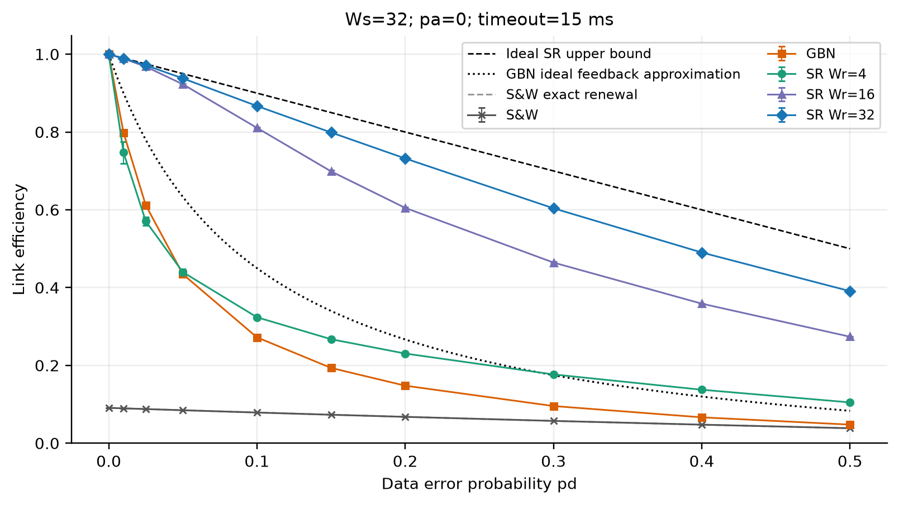
Figure 2. Efficiency versus pd with Ws=32, pa=0, and timeout 15 ms. SR uses Wr=4,16,32. Analytical reference curves are described in the text.

With Ws=32, all pipelined settings reach full efficiency at pd=0. At pd=0.1, GBN efficiency is 0.2722, while SR gives 0.3238, 0.8108, and 0.8670 for Wr=4,16,32. At pd=0.5 these fall to 0.0478 for GBN and 0.1050, 0.2738, and 0.3909 for SR. S&amp;W gives 0.0789 at pd=0.1, close to the exact renewal prediction 0.07895.

Ideal SR predicts 0.9 at pd=0.1 and 0.5 at pd=0.5. Wr=32 avoids losses caused by a too-small receive window, but its finite send window can still stall behind an unacknowledged packet. Smaller Wr also discards valid packets beyond a gap, increasing recovery traffic. The small Wr=4 case can be worse than GBN at low nonzero pd; individual ACKs do not compensate for inadequate buffering in every operating region.

The GBN analytical reference gives 0.45 at pd=0.1, above the measured 0.2722. Its approximate 11-packet retransmission span omits the full timer behavior in this implementation. Our GBN sender waits for timeout and may send or retry packets that the receiver must discard while an earlier gap remains. Cumulative timer restarts also affect recovery time. Thus the simulation matches the error-free limit and the qualitative loss trend, while the simple approximation overestimates this implementation's efficiency under errors.

## Experiment 3(b): Effect of Send Window on Efficiency


Figure 3. Efficiency versus Ws with pd=0.1, pa=0, and timeout 15 ms. Error bars are 95% intervals across five seeds.

Larger windows help SR when enough receive buffering is available. For Wr=32, efficiency rises from 0.2564 at Ws=4 to 0.5300 at Ws=11, 0.8670 at Ws=32, and 0.8935 at Ws=64. The error-free saturation point of 11 packets is no longer sufficient for near-maximum useful throughput: extra outstanding packets keep the link active during recovery.

With Wr=4, increasing Ws eventually becomes harmful. Efficiency is 0.4325 at Ws=11, 0.4319 at Ws=16, and 0.3238 at Ws=32. Later packets leave the receiver's acceptance window while earlier gaps persist. Their discarded transmissions consume capacity and create more timeout work. Ws and Wr therefore need to be considered together.

GBN improves from 0.1996 at Ws=4 to about 0.2727 at Ws=11, then stays near 0.2722 for large windows. It cannot retain the later packets arriving behind a missing packet. Once the pipeline is covered, increasing Ws mainly adds outstanding work rather than useful deliveries. S&amp;W remains near 0.0789 throughout.

## Experiment 3(b): Data Transmission Attempts

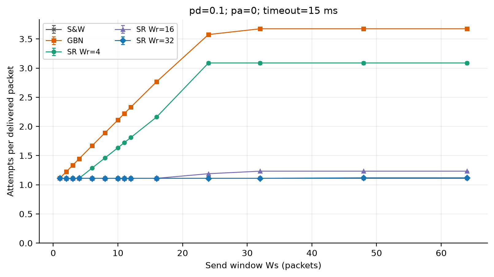
Figure 4. Attempts per successfully delivered packet versus Ws for the same runs as the preceding figure. Every initial attempt and retry is counted.

GBN uses 1.446 attempts per delivered packet at Ws=4, 2.223 at Ws=11, and 3.674 at Ws=32. The latter is far above the independent data-error minimum 1/(1-0.1)=1.111. Most of that extra cost comes from packets arriving out of order and from retransmission of the outstanding window.

SR with Wr=32 remains near 1.111 attempts while Ws is at most 32. Its efficiency can still be below 0.9 because the link sometimes waits for an ACK; low retransmission overhead alone does not guarantee full utilization. At Ws=64, attempts rise slightly to 1.119 because the receiver may reject packets beyond its 32-position window.

For Wr=4, attempts rise from 1.111 at Ws=4 to 1.723 at Ws=11 and 3.088 at Ws=32. This supports the efficiency result: a send window much larger than the receiver window can turn buffering limits into repeated data transmissions. The curves level out for large Ws under this particular timing and retry policy; they should not be read as a universal optimal window size.

## Experiment 4: Data and ACK Errors


Figure 5. Efficiency versus pa with pd=0.1, Ws=32 for GBN/SR, and timeout 15 ms. Window sizes match Experiment 3(a).

Adding ACK errors reduces S&amp;W efficiency from 0.0789 at pa=0 to 0.0689 at pa=0.1 and 0.0340 at pa=0.5. For SR with Wr=32 the corresponding values are 0.8670, 0.7460, and 0.3443. Each individual ACK is needed to release its sender sequence position, even when the receiver already has the packet.

GBN changes much less: its efficiency is 0.2722 at pa=0 and 0.2651 at pa=0.5. A later cumulative ACK can acknowledge several earlier packets, so an isolated lost ACK often causes no timeout. Data errors are more damaging because a missing packet prevents in-order reception of all following data. This explains why changing pd and changing pa have different effects on GBN.

ACK loss also changes which resource limits SR. With pa=0.5, Wr=16 and Wr=32 give nearly equal efficiencies, 0.3434 and 0.3443, because individual feedback and sender-window waiting dominate. Wr=4 remains constrained by its receive window, although the slower sender caused by lost ACKs can reduce some out-of-window traffic. More buffering is helpful, but its benefit depends on both error probabilities.

## Experiment 4: Retransmission Cost of ACK Errors

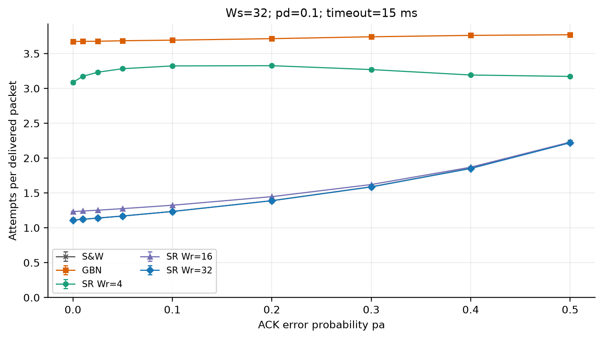
Figure 6. Attempts per delivered packet versus pa for the same settings as Experiment 4's efficiency plot.

For S&amp;W, a transmission cycle succeeds with probability q=(1-pd)(1-pa). With pd=0.1 and pa=0.5, 1/q=2.222 attempts are expected, compared with 2.230 measured. SR with Wr=32 gives 2.220 at the same point. A lost ACK causes a duplicate transmission even though the data may already be delivered; the duplicate is acknowledged without another delivery.

GBN increases only from 3.674 attempts at pa=0 to 3.771 at pa=0.5. Its starting cost is already high because of data gaps, but cumulative ACKs absorb much of the additional ACK loss. In contrast, SR with Wr=32 increases from 1.111 to 2.220, approximately doubling its transmission cost.

The Wr=4 curve is not strictly increasing: it uses 3.088 attempts at pa=0, 3.323 at pa=0.1, and 3.172 at pa=0.5. ACK loss adds duplicates but also delays sender advancement, which can reduce discards outside the small receive window. The net attempts metric reflects both effects. Its efficiency still falls from 0.3238 to 0.2805 between pa=0 and 0.5, so the reduced discard pressure does not make ACK errors beneficial overall.

## Experiment 5: Retransmission Timeout and Efficiency


Figure 7. Efficiency versus timeout with pd=pa=0.1 and Ws=32 for GBN/SR. The vertical line marks the 11 ms data-to-ACK cycle.

Timeouts range from 2 to 120 ms, covering values below the 10 ms round-trip propagation delay, near the full 11 ms feedback cycle, and much longer than either. For SR with Wr=32, efficiency is 0.1604 at 2 ms, 0.4475 at 10 ms, 0.7943 at 11 ms, 0.7460 at 15 ms, and 0.1613 at 120 ms. Premature retries occupy the data link; long timers leave sequence positions blocked after losses.

The sharp change at 11 ms follows from fixed delays and ACK-first tie handling. It is the smallest timeout that avoids premature retries in the error-free model. With delay variation, a margin above this value would be needed. The best measured SR Wr=32 setting is therefore specific to the deterministic timing assumed here.

S&amp;W behaves differently: at 2 ms it reaches 0.0872 efficiency, higher than 0.0689 at 15 ms, but spends many more attempts. Since it normally leaves the link idle while waiting, early duplicate copies can recover a failed attempt sooner without displacing other useful packets. GBN also has nonmonotonic behavior; for example it reaches 0.3871 at 6 ms versus 0.2708 at 15 ms. Short timers can accelerate gap recovery, but their transmission cost must also be considered.

## Experiment 5: Timeout and Transmission Attempts

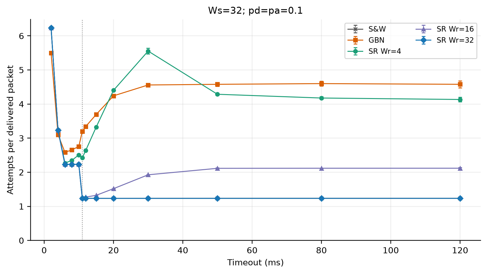
Figure 8. Attempts per delivered packet versus timeout with pd=pa=0.1. Short timers create duplicate traffic before ACKs can return.

At a 2 ms timeout, S&amp;W and the three SR settings use about 6.23 attempts per packet. Several copies can be transmitted before any ACK arrives. Increasing the timeout to 11 ms reduces S&amp;W and SR Wr=32 to about 1.235 attempts, agreeing with 1/(0.9 times 0.9)=1.2346. For these settings, still longer timers mainly increase waiting rather than the number of retries needed per acknowledged packet.

GBN's attempt count is 5.501 at 2 ms, 2.583 at 6 ms, 3.693 at 15 ms, and 4.580 at 120 ms. Its timer controls a group of packets rather than one packet. Changes in timer length alter both the recovery delay and how many later packets reach a receiver that is still waiting for a gap.

SR with Wr=4 also has a nonmonotonic cost: 3.323 attempts at 15 ms, 5.554 at 30 ms, and 4.135 at 120 ms. A long wait can allow many packets outside the receive window to be discarded, but eventually the blocked sender spends more time idle. At 120 ms its efficiency is only 0.0658. Timer selection should therefore be judged using both efficiency and transmission attempts, rather than minimizing either measure alone.

## Experiment 6: Finite Transfer without Errors

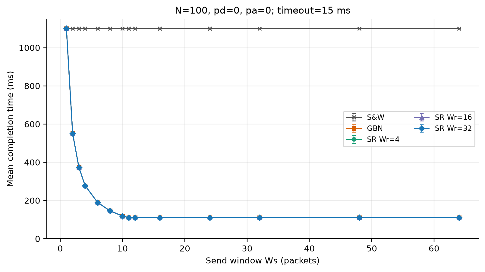
Figure 9. Mean completion time versus Ws for N=100, pd=0, pa=0, and timeout 15 ms. SR uses Wr=4,16,32.

With no errors, GBN and all SR settings coincide. Completion time falls from 1100 ms at Ws=1 to 278 ms at Ws=4 and 110 ms at Ws=11. It remains 110 ms for larger windows. All 100 data packets require 100 ms of serialization, and the final ACK returns 10 ms after the last packet finishes transmission. S&amp;W waits through all 100 feedback cycles and takes 1100 ms.

The finite-transfer result differs from the backlogged utilization measure. Even when the data link is fully occupied during transmission, the transfer includes the final propagation and feedback delay. Its useful-bit efficiency is 100/110=0.9091 rather than 1. Receive-window size has no effect because arrivals remain in order.

All N packets are present at t=0, and completion is recorded only after the sender has received ACKs covering every packet. Error cases average 1000 complete transfers per point. No backlogged steady-state estimate is substituted for the finite-transfer measurement.

## Experiment 6: Finite Transfer with Data Errors

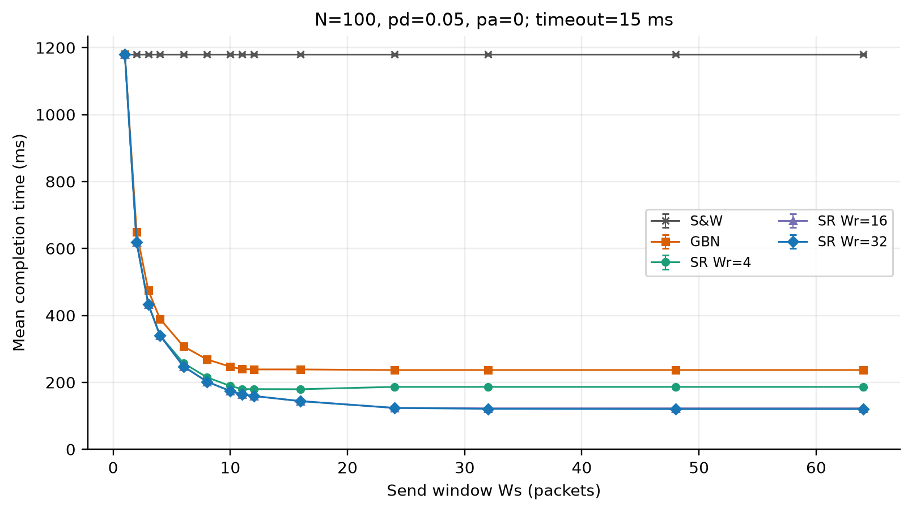
Figure 10. Mean completion time versus Ws for N=100, pd=0.05, pa=0, and timeout 15 ms. SR uses Wr=4,16,32.

At Ws=32, GBN takes 237.04 ms on average, compared with 186.69, 122.58, and 121.11 ms for SR with Wr=4,16,32. The respective 95% interval half-widths are 3.48, 2.21, 0.56, and 0.46 ms. S&amp;W takes 1179.50 ms. Its analytical mean is 100[11+15(0.05/0.95)]=1178.95 ms, within the measured interval.

Errors make extra send-window space useful to well-buffered SR. Wr=32 improves from 163.99 ms at Ws=11 to 121.11 ms at Ws=32. GBN changes little over that range because it cannot keep data arriving after a gap. The small Wr=4 receiver is fastest among those two points near Ws=11: its mean increases from 180.10 to 186.69 ms as the larger sender causes extra discards.

All N packets are present at t=0, and completion is recorded only after the sender has received ACKs covering every packet. Error cases average 1000 complete transfers per point. No backlogged steady-state estimate is substituted for the finite-transfer measurement.

## Experiment 6: Finite Transfer with Data and ACK Errors

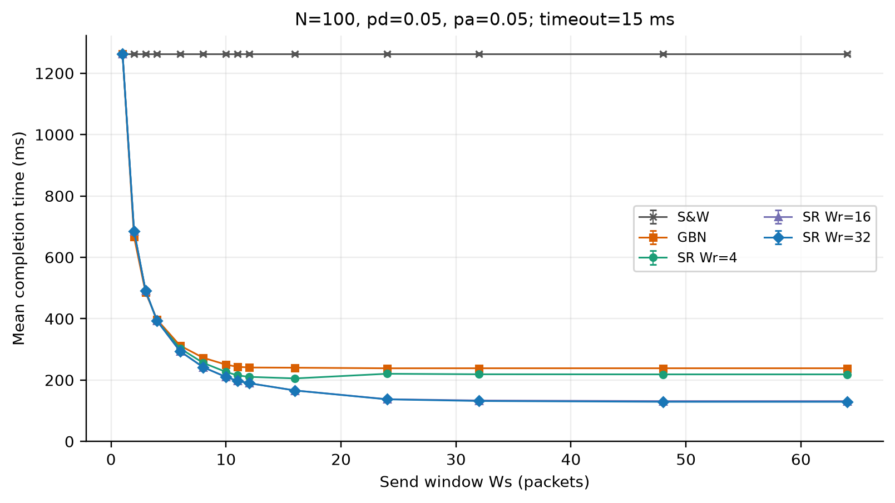
Figure 11. Mean completion time versus Ws for N=100, pd=0.05, pa=0.05, and timeout 15 ms. SR uses Wr=4,16,32.

At Ws=32, GBN takes 238.57 ms and SR takes 218.97, 133.58, and 131.88 ms for Wr=4,16,32. Relative to the data-error-only case, the added ACK loss costs about 1.53 ms for GBN but 10.77 ms for SR Wr=32. Later cumulative ACKs often cover GBN's lost feedback; SR must recover missing individual ACKs.

S&amp;W rises to 1263.23 ms, close to its analytical mean of 1262.05 ms using q=0.95 squared. A lost final ACK is especially important for finite transfers: no later new packet is available to generate feedback that would finish the transfer. Increasing SR's Ws from 32 to 64 lowers the Wr=32 mean from 131.88 to 129.15 ms, but the gain is small compared with the improvement from Ws=11 to 32.

All N packets are present at t=0, and completion is recorded only after the sender has received ACKs covering every packet. Error cases average 1000 complete transfers per point. No backlogged steady-state estimate is substituted for the finite-transfer measurement.

## Experiment 7: Transfer Size without Errors

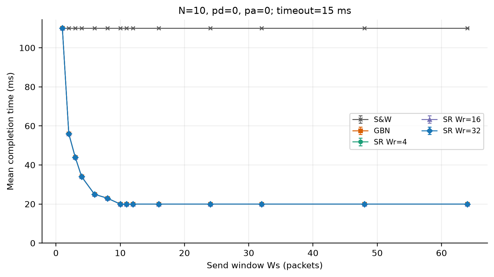
Figure 12. N=10 packets, pd=0, pa=0; timeout 15 ms.

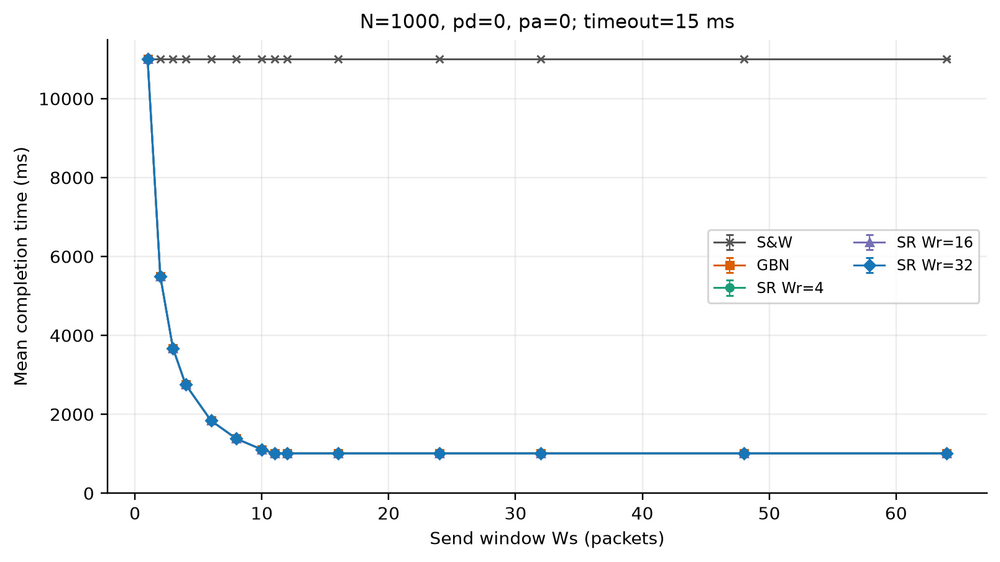
Figure 13. N=1000 packets with the same errors and window settings.

## Experiment 7: Transfer Size with Data Errors

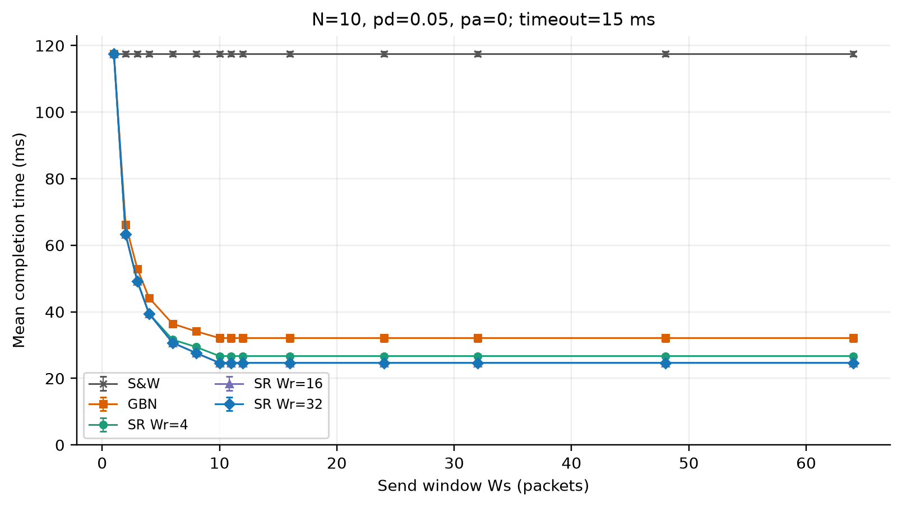
Figure 14. N=10 packets, pd=0.05, pa=0; timeout 15 ms.

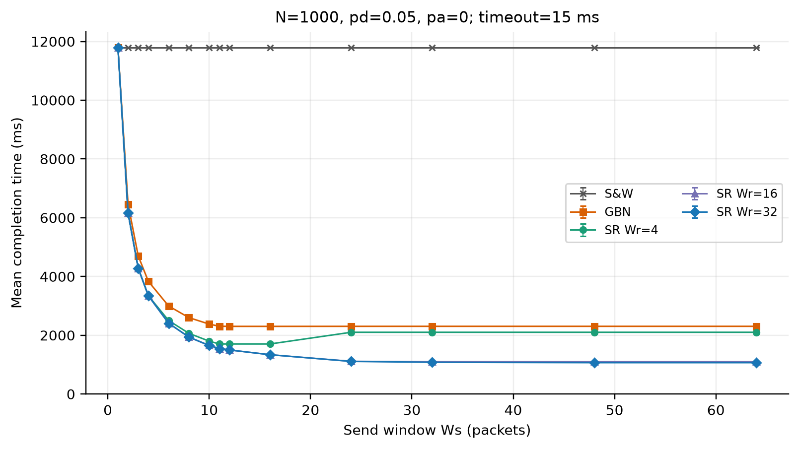
Figure 15. N=1000 packets with the same errors and window settings.

## Experiment 7: Transfer Size with Data and ACK Errors


Figure 16. N=10 packets, pd=0.05, pa=0.05; timeout 15 ms.


Figure 17. N=1000 packets with the same errors and window settings.

## Experiment 7: Comparison of Transfer Sizes

Table 8. Mean completion times in ms at Ws=32. Both errors means pd=pa=0.05; SR32 means Wr=32.

| N | GBN, no errors | SR32, no errors | GBN, both errors | SR32, both errors |
| --- | --- | --- | --- | --- |
| 10 | 20.00 | 20.00 | 33.62 | 29.18 |
| 100 | 110.00 | 110.00 | 238.57 | 131.88 |
| 1000 | 1010.00 | 1010.00 | 2312.50 | 1165.45 |

Without errors, the best completion times are 20, 110, and 1010 ms for N=10,100,1000. The final 10 ms feedback overhead is half of the ten-packet transfer but only about 1% of the thousand-packet transfer. For N=10, Ws=10 is already large enough to send the whole file without waiting. Windows larger than the file cannot help. For N=1000, the window must keep the pipeline busy over many feedback cycles, and completion per packet approaches the backlogged rate.

With pd=0.05 and pa=0, Ws=32 gives GBN means of 32.13, 237.04, and 2305.45 ms as N grows, compared with 24.67, 121.11, and 1080.83 ms for SR Wr=32. The larger file exposes sustained retransmission overhead; GBN's completion time per packet is about 2.31 ms at N=1000, compared with 1.08 ms for SR. A small file is more influenced by whether its few packets happen to encounter any losses.

Adding pa=0.05 increases the N=1000 means to 2312.50 ms for GBN and 1165.45 ms for SR Wr=32. SR's missing individual ACKs slow window advancement throughout the larger transfer. For N=10 the means are 33.62 and 29.18 ms, and final-ACK recovery accounts for a larger fraction of the transfer. The effect of ACK errors therefore depends on both protocol feedback and file length.

A small receive window remains a limitation even for large files. With N=1000 and both errors, SR Wr=4 takes 2063.08 ms at Ws=11 but 2635.79 ms at Ws=32, which is slower than GBN at that larger window. This is consistent with Experiment 3(b): increasing only the sender window can create more discarded packets rather than shorten the transfer.

## Simulation Reliability and Limitations:

Table 9. Selected checks using 200,000 ms warmup and 2,000,000 ms measurement. x is the swept variable in the named experiment.

| Operating point | Original efficiency | Longer efficiency | Change (%) |
| --- | --- | --- | --- |
| Exp. 3a, SR Wr=4, x=0.01 | 0.74727 | 0.74474 | -0.338 |
| Exp. 3a, GBN, x=0.5 | 0.04781 | 0.04765 | -0.336 |
| Exp. 3a, SR Wr=32, x=0.5 | 0.39093 | 0.39041 | -0.135 |
| Exp. 3b, SR Wr=4, x=64 | 0.32383 | 0.32459 | +0.235 |
| Exp. 4, GBN, x=0.5 | 0.26505 | 0.26513 | +0.027 |
| Exp. 4, SR Wr=32, x=0.5 | 0.34434 | 0.34417 | -0.048 |
| Exp. 5, GBN, x=2 | 0.18180 | 0.18173 | -0.040 |
| Exp. 5, SR Wr=32, x=2 | 0.16040 | 0.16039 | -0.003 |
| Exp. 5, S&W, x=120 | 0.02542 | 0.02556 | +0.538 |
| Exp. 5, SR Wr=4, x=120 | 0.06579 | 0.06557 | -0.335 |

The longer runs changed the ten selected efficiency means by at most 0.54%. Each paired change was within its 95% interval. This supports the reported trends, although it does not prove that every small difference between adjacent points is statistically meaningful. The largest original backlogged efficiency interval was 3.75% of the mean, for SR Wr=4 at pd=0.01; its longer-run interval fell to about 1.91%. Rare losses can trigger long periods of extra retries with this small receive window.

Finite-transfer confidence intervals use within-seed replication variance as well as differences between seed means. Raw CSV files include each seed's repetition count, mean, and standard deviation so the pooled intervals can be recalculated. The no-error results are deterministic and do not need confidence intervals. Independent seeds and replications quantify random variation; they do not remove model assumptions.

The model assumes fixed propagation, instantaneous ACK transmission, independent errors, and unbounded sequence numbers. It omits burst errors, changing link delay, processing load, ACK bandwidth limits, and sequence-number wraparound. These conditions would change timer choices and possibly protocol rankings. The 11 ms timer result should therefore not be used as a practical network setting without accounting for delay variation.

Backlogged attempts and deliveries are counted in the same fixed interval, so in-flight packets at its boundaries can cause small differences from lifetime per-packet ratios. The longer-run check reduces this effect. The analytical GBN curve is an approximation with different recovery assumptions, while the S&amp;W and error-free finite-transfer expressions are exact under the stated model.

## Conclusions and Submission Files:

With no errors, a send window of 11 packets covers the feedback cycle and fully uses the data link. GBN and SR have the same efficiency in that case. Under data errors, SR benefits from keeping correctly received packets behind a gap, provided its receive window is large enough. A large sender window paired with a small receiver window can increase discards and retransmission cost.

Cumulative ACKs make GBN less sensitive to isolated ACK losses than S&amp;W or individually acknowledged SR. A timeout below the feedback cycle causes duplicate traffic, while a long timeout delays recovery. Short timers can raise S&amp;W efficiency by using otherwise idle link time, but require many more transmissions. For finite transfers, the final ACK and recovery of the last packets matter most for small files; larger files reveal sustained throughput differences.

The code archive contains the C simulator, verification tests, experiment scripts, plotting and report scripts, raw results, summary tables, event traces, and figures. It excludes the local course manual, previous report, temporary render files, and compiled executables. The public repository records implementation and each experiment in separate commits.

## Reproduction commands:

```text
python -m pip install -r requirements.txt
python scripts/test_arq.py
python scripts/verify.py
python scripts/experiments.py 2
python scripts/plots.py 2
# Repeat the preceding two commands for 3a,3b,4,5,6,7.
python scripts/reliability.py
python scripts/report.py
```

## References:

[1] Computer Engineering 4DK4, Lab 4: Simulation of ARQ Protocols, 2026, pp. 1-5. Experiment settings and submission requirements.

[2] Simon S. Lam, University of Texas at Austin, Chapter 3: Transport Layer, 2017, slides 3-44 to 3-47. Analytical SR and GBN utilization references. Course slides.

[3] Group 25, COE4DK4 Lab 4 source and results. GitHub repository.
